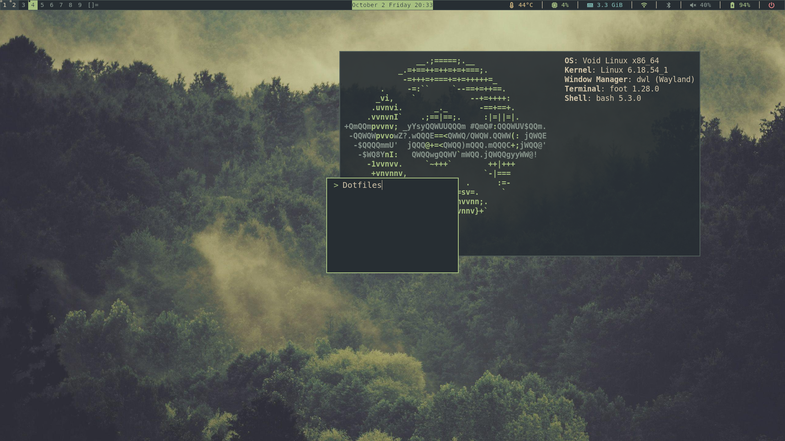

# Everforest dotfiles

My personal Everforest setup for dwl, dwlb, Foot, and Fuzzel.


## Screenshot




## Included

- Foot and Fuzzel configs.
- Neovim config, shortcut reference, and a pinned Everforest theme fetched by the installer.
- Bash config and tty1 session startup.
- `everbar`: native C status daemon for clock, battery, temperature, CPU, RAM,
  Wi-Fi, Bluetooth, volume, and power actions.
- `everbar-start`: bar theme, startup options, and optional wallpaper startup.
- Customized dwl files: colors, gaps, keybindings, input settings,
  build changes, and dwl IPC v2 support.
- Customized dwlb files, including a bar outline.
- Keybinding reference.
- Upstream URLs and base commits in `SOURCE-BASES.txt`.
- Full user-local installer with preview, pinned source builds, backups and restore.

`src/everbar` is a complete, buildable project. For dwl and dwlb, only selected
source files are included, not complete buildable source trees; those files
target the exact upstream commits recorded in `SOURCE-BASES.txt`.

## Install the whole setup

Run as your regular desktop user, **not with sudo**:

```sh
./install.sh --dry-run  # inspect all destinations; no writes or downloads
./install.sh --check    # check build dependencies and runtime warnings
./install.sh            # confirm, build, back up and install ALL components
```

The installer builds fresh everbar/dwl/dwlb binaries on your machine. It fetches
the exact upstream commits in `sources.lock.json`, overlays the customized dwl
and dwlb files, and installs the Neovim theme required by `packadd everforest`.
All configuration files are installed in their live locations. Documentation,
licenses, screenshot, source files and tests are also installed as a source-only
snapshot under `${XDG_DATA_HOME:-~/.local/share}/everforest-dotfiles`.

**The shell component replaces `.bash_profile` and enables dwl startup on tty1.**
Existing files are backed up, never silently discarded. Installation does not
stop/restart your desktop or change system services. See
[docs/install.md](docs/install.md) for dependencies, destination maps, component
selection, restore, and limitations.

```sh
./install.sh --only everbar,scripts --yes  # just the bar and its launcher
./install.sh --only shell,foot,fuzzel,nvim # just these configuration components
./install.sh --restore BACKUP_ID          # restore an install's previous files
```

## Build everbar

Build on the machine where the bar will run (not inside a container using a
different C library). On Void Linux, the build dependencies are:

```sh
sudo xbps-install -S base-devel pkg-config dbus-devel pipewire-devel
```

If XBPS reports a D-Bus version conflict, first update the system with
`sudo xbps-install -Su` (repeat if XBPS itself was updated), then install
`dbus-devel pipewire-devel`. Do not force incompatible library versions.

Then, from this repository:

```sh
make -C src/everbar clean
make -C src/everbar
make -C src/everbar test
```

Python 3.9+ is needed for the installer/tests, not for the installed everbar
daemon. Timezone data is needed at runtime too. Before using the standalone
everbar Makefile install target, stop the old process and back up your current
`~/.local/bin/everbar`. Install the new binary with:

```sh
make -C src/everbar install
```

The existing `scripts/everbar-start` is unchanged and launches the installed
binary at the same path. Do not launch a second `everbar-start` inside an already
running session: it starts another dwlb and wallpaper process. Restart only
everbar, or log out and back in.

The rewrite preserves the Everforest status markup, icons, spacing, Oslo clock
and click actions. It talks directly to dwlb's sockets, NetworkManager/BlueZ over
system D-Bus, and PipeWire, without periodically starting helper programs.
See [docs/everbar.md](docs/everbar.md) for design, testing, and upgrade details.

## Assumptions

- dwl's IPC v2 changes are already present in the included `dwl.c`,
  Makefile, and protocol XML. The bar starts with `-ipc` and expects
  that compositor support.
- dwlb supports the startup options and clickable status commands used here.
- dwl is built against wlroots 0.19; XWayland is disabled in the recorded base.
- Bar appearance mainly comes from `everbar-start`, not `dwlb/config.h`.
- The keyboard layout is Norwegian.
- The clock uses `Europe/Oslo`.
- Temperature detection expects `x86_pkg_temp`.
- Brightness keys target `acpi_video0`.
- Session startup assumes tty1, D-Bus, PipeWire, and a valid `XDG_RUNTIME_DIR`.
- Timezone data, Foot, Fuzzel, NetworkManager, BlueZ, PipeWire,
  WirePlumber, `loginctl`, and `brightnessctl` are available as needed.
- Everbar links against libdbus-1 and libpipewire-0.3; no systemd dependency
  or PulseAudio compatibility server is required.
- Adwaita cursors and Symbols Nerd Font Mono are installed.

## Not included

- Complete upstream source trees, compiled binaries, or generated build files.
- `lock-screen` and `shot-copy`, which are referenced by keybindings.
- Wallpaper, expected at `~/.local/share/backgrounds/wallpaper`.
- `swaybg`, used for wallpaper when available.
- Autologin service files or system-service setup.
- GTK/Qt, browser, or screen-locker themes.

This is a personal configuration snapshot. Some settings are hardware-specific,
and known code issues remain.

## License and credits

GPL-3.0-or-later. Original upstream licenses and attribution notices are retained.

Original personal setup and project direction: **iGotUsername**. The native C
everbar rewrite, installer, and their new tests/documentation were written by
**GPT-6.1 Sol via OpenCode**, at the maintainer's request. See
[AUTHORS.md](AUTHORS.md) for the full attribution and upstream credits.

- dwl: https://codeberg.org/dwl/dwl
- dwlb: https://github.com/kolunmi/dwlb
- Everforest: https://github.com/sainnhe/everforest
